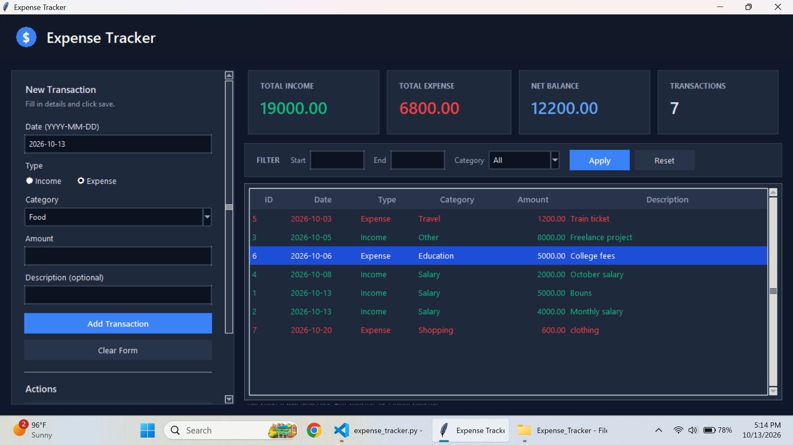
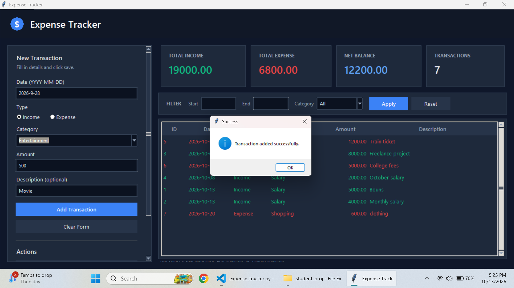
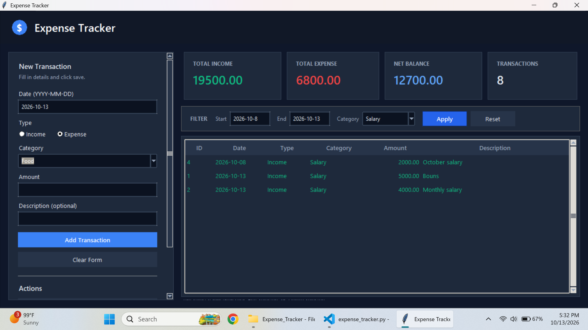
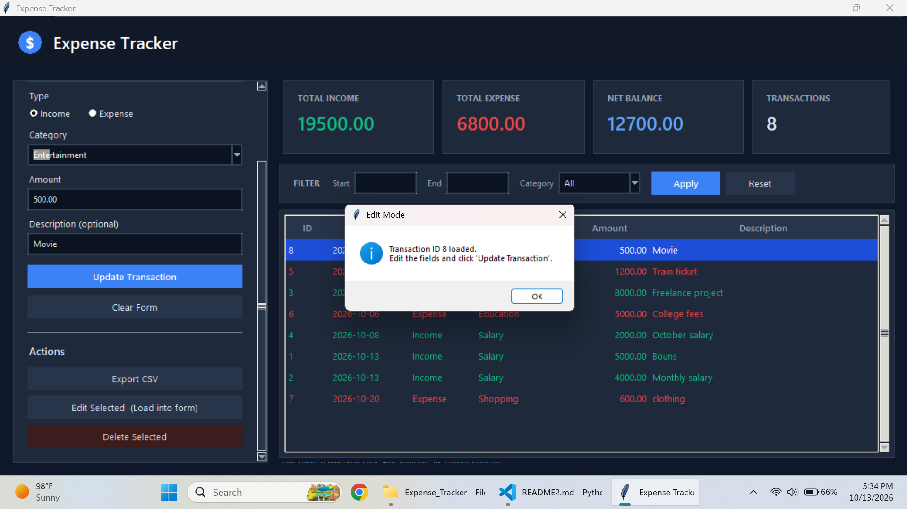
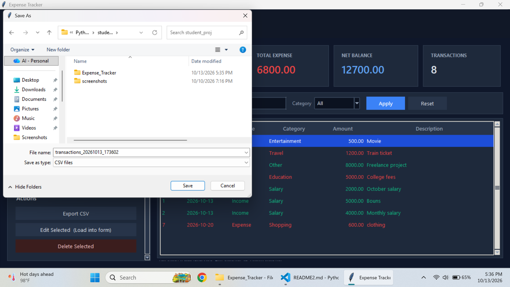
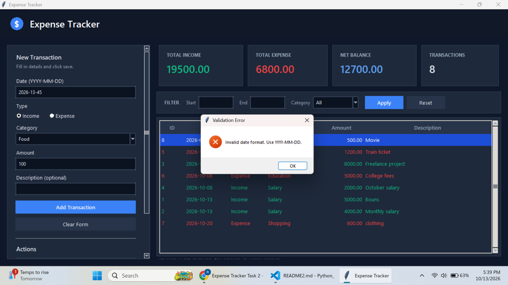

# Expense Tracker

A Python-based GUI application to manage income and expenses. It includes Add, View, Update, Delete, Filter, Summary, and Export features.

## How to Run

1. Ensure Python 3.8 or higher is installed.
2. Open Terminal or Command Prompt.
3. Navigate to the project folder.
4. Run the following command:

   python expense_tracker_gui.py

5. The application window will open automatically.
   - Use the form on the left to add transactions.
   - View, edit, delete, and filter records using the table and buttons.

## Features

- Add income and expense transactions
- View all transactions in a table
- Update transaction details
- Delete transaction
- Filter by date range and category
- Live summary cards (Total Income, Total Expense, Net Balance, Count)
- Color-coded table (green = income, red = expense)
- Export data to CSV file
- Save data locally in JSON format
- Input validation (date, amount, type, category)
- Handles corrupted data file gracefully

## Tech Stack

- Python 3.x
- Tkinter (GUI)
- JSON (Data Storage)
- CSV (Export)
- Decimal (Accurate money math)

100% free to use. No paid tools required.

## Files

- expense_tracker_gui.py   → Main application
- data/transactions.json   → Database (auto-created on first run)
- README.md                → This file
- exports/                 → CSV exports folder

## Author

Raheela Bhutto
CodeNova Batch 01 — Python Track

## Screenshots

### 1. Main Window

### 2. Add Transaction

### 3. Filter Applied

### 4. UPDATE 

### 5. CSV Export

### 6. Validation Error

